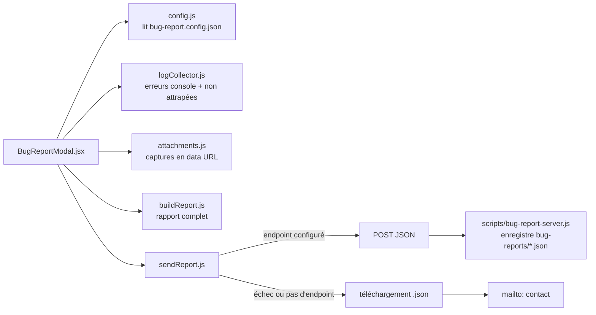

# Signaler un bug

Le bouton **Bug** du menu principal ouvre un formulaire qui envoie un rapport complet à la
personne responsable du jeu.

---

## Pour le joueur

1. Menu principal → bouton **Bug**.
2. Remplir le formulaire :

   | Champ | Obligatoire | Contenu |
   |---|---|---|
   | **What happened?** | oui (10 caractères min.) | ce qui ne va pas |
   | Steps to reproduce | non | comment refaire le bug |
   | Your e-mail | non | pour recevoir une réponse |
   | Screenshots | non | jusqu'à 5 images, 5 Mo max chacune |
   | Include my game files | coché | sauvegardes, profils et réglages |
   | Include error logs | coché | les 200 derniers messages d'erreur du jeu |

3. **Send report**. Deux cas :
   - **« Your report has been sent »** : le rapport est arrivé au serveur. C'est terminé.
   - **« Your report was saved as bug-….json »** : le serveur n'est pas joignable (ou pas
     configuré). Le rapport est téléchargé ; si un contact est configuré, un e-mail prérempli
     s'ouvre : **joindre le fichier téléchargé** à cet e-mail et l'envoyer.

> Les fichiers de jeu contiennent les noms des profils et la progression. Décocher la case si
> vous ne souhaitez pas les envoyer.

---

## Pour la personne qui configure (pas besoin de savoir coder)

Tout se règle dans **un seul fichier** :

- dans le code source : `CodeWashGame/CodeWashGame/public/bug-report.config.json` ;
- dans un jeu déjà compilé : `bug-report.config.json`, **à côté de `index.html`** dans le dossier
  `dist/`. Pas besoin de recompiler.

```json
{
  "contactEmail": "responsable@ecole.fr",
  "endpoint": "http://localhost:8787/bug-reports"
}
```

| Champ | Rôle | Si vide |
|---|---|---|
| `contactEmail` | adresse qui reçoit l'e-mail prérempli (mode de secours) et qui est affichée dans le formulaire | pas d'e-mail, le joueur garde seulement le fichier |
| `endpoint` | adresse du serveur qui reçoit les rapports | le rapport est toujours téléchargé + e-mail |

Valeur livrée : serveur local de démonstration (`localhost:8787`), sans adresse e-mail.

---

## Recevoir les rapports

Un petit serveur de réception est fourni. Il enregistre chaque rapport dans un fichier JSON.

```bash
cd CodeWashGame/CodeWashGame
npm run bug-report-server
# Réception des rapports de bug sur http://localhost:8787/bug-reports
# Rapports enregistrés dans …/bug-reports
```

| Variable | Défaut | Rôle |
|---|---|---|
| `BUG_REPORT_PORT` | `8787` | port d'écoute |
| `BUG_REPORT_DIR` | `bug-reports` | dossier où les rapports sont enregistrés (ignoré par Git) |

Vérifier qu'il tourne : http://localhost:8787/health doit répondre `{"status":"ok"}`.

Pour une utilisation réelle dans une école, ce serveur doit tourner sur une machine accessible par
les postes des élèves. Mettre son adresse dans `endpoint`.

### Contenu d'un rapport

```json
{
  "id": "bug-2026-11-28T10-00-00-000Z-k3x9a1",
  "createdAt": "2026-11-28T10:00:00.000Z",
  "description": "…", "steps": "…", "reporterEmail": "…",
  "environment": { "userAgent": "…", "url": "…", "viewport": "1280x720", "language": "fr-FR" },
  "logs": [{ "time": "…", "level": "error", "message": "…" }],
  "gameData": { "heroSkills_v23_p1": "…", "currentProfile_v1": "1" },
  "attachments": [{ "name": "capture.png", "type": "image/png", "size": 12345, "dataUrl": "data:image/png;base64,…" }]
}
```

Pour **rejouer le bug d'un joueur** : copier les valeurs de `gameData` dans le `localStorage` du jeu
(DevTools → Application → Local Storage).

---

## Pour les développeurs

### Architecture



| Fichier | Responsabilité |
|---|---|
| `src/bugReport/logCollector.js` | tampon des 200 derniers `console.error` / `console.warn` et erreurs non attrapées ; installé dans `src/main.jsx` |
| `src/bugReport/config.js` | chargement et validation de la configuration |
| `src/bugReport/buildReport.js` | validation du formulaire et construction du rapport |
| `src/bugReport/attachments.js` | validation et lecture des captures d'écran |
| `src/bugReport/sendReport.js` | envoi HTTP, repli téléchargement + e-mail |
| `src/components/modals/BugReportModal.jsx` | formulaire |
| `scripts/bug-report-server.js` | serveur de réception |
| `electron/main.cjs` | ouvre les liens `mailto:` dans le client e-mail du système |

Toutes les dépendances difficiles à tester (horloge, stockage, réseau, `FileReader`, `document`,
`window.open`, console) sont **injectées** avec une valeur par défaut réelle.

### Tests

```bash
npm test
```

- Chaque module est testé unitairement (couverture 100 %).
- `BugReportModal.test.jsx` teste le formulaire avec des services simulés, puis avec les vrais
  services (seul `fetch` est simulé).
- **Preuve de réception** (`sendReport.test.js`, « réception par le serveur ») : le test démarre le
  **vrai serveur** sur un port libre, envoie un rapport avec le **vrai code d'envoi du jeu**, et
  vérifie que le fichier JSON enregistré est identique au rapport envoyé.
- `scripts/__tests__/bug-report-server.test.js` : santé, CORS, rapport valide ou invalide, corps
  trop volumineux, noms de fichiers dangereux (`../../etc/passwd`).

### Limites connues

- Pas de capture d'écran **automatique** : le joueur joint ses propres images (choix de périmètre).
- Les textes du formulaire sont en anglais, comme le reste du jeu, en attendant la mission
  Translation.
- Le serveur fourni n'a pas d'authentification : à n'utiliser que sur un réseau de confiance.
